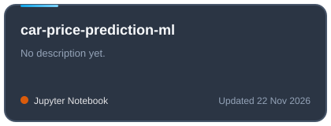
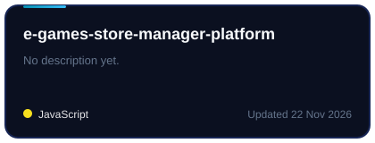
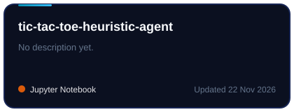
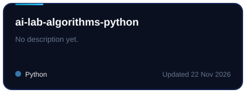
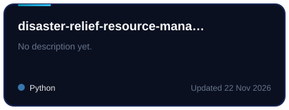
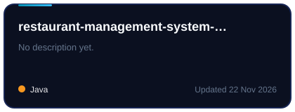
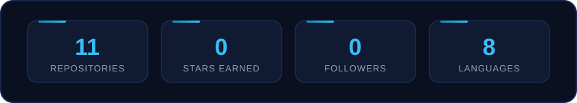

## About

I'm a Computer Science student at COMSATS University Islamabad, focused on software development, artificial intelligence and machine learning. I learn by building: my projects so far span Python applications, Java object-oriented design, C++ data structures, database systems and web development.

Currently working on [**car-price-prediction-ml**](https://github.com/uzairnasir0412/car-price-prediction-ml)

## Featured Projects

 

 

[View all repositories →](https://github.com/uzairnasir0412?tab=repositories)

## Tech Stack

## Coursework

| Area | Subjects |
|:--|:--|
| Artificial Intelligence & ML | Artificial Intelligence & RAG Applications, Machine Learning |
| Core Computer Science | Data Structures & Algorithms, Object-Oriented Programming, Operating Systems |
| Databases | Database Systems, Advanced Database (MongoDB) |
| Web | Web Development (HTML, CSS, JavaScript) |

## GitHub Overview

## Recent Activity

No recent public activity.

## Contact

