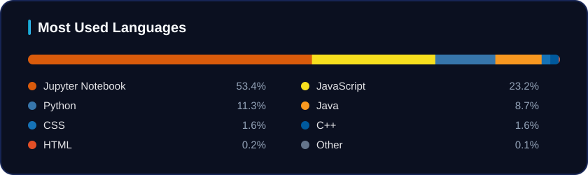

<div align="center">


<br/>

<a href="https://github.com/uzairnasir0412"></a>


</div>

---

## 👨‍💻 About Me

Hello! I'm **Uzair Nasir**, a Computer Science student at **COMSATS University Islamabad**, interested in software development, Artificial Intelligence, Machine Learning, databases, and problem-solving.

```python
class UzairNasir:
    university = "COMSATS University Islamabad"
    studying   = "Computer Science"
    interests  = ["Artificial Intelligence", "Machine Learning", "Software Engineering", "Databases"]
    languages  = ["Java", "C++", "Python", "JavaScript"]
    motto      = "Learn • Build • Improve • Repeat"
```

🔭 **Currently working on:** [**car-price-prediction-ml**](https://github.com/uzairnasir0412/car-price-prediction-ml)

---

## 🚀 Latest Projects

> 🔄 *This section updates automatically whenever I push to a repository.*

| 📦 Project | 📝 Description | 💻 Language | ⭐ Stars | 🕒 Updated |
|:--|:--|:--|:-:|:-:|
| [**car-price-prediction-ml**](https://github.com/uzairnasir0412/car-price-prediction-ml) | — |  | 0 | 22 Nov 2026 |
| [**e-games-store-manager-platform**](https://github.com/uzairnasir0412/e-games-store-manager-platform) | — |  | 0 | 22 Nov 2026 |
| [**tic-tac-toe-heuristic-agent**](https://github.com/uzairnasir0412/tic-tac-toe-heuristic-agent) | — |  | 0 | 22 Nov 2026 |
| [**ai-lab-algorithms-python**](https://github.com/uzairnasir0412/ai-lab-algorithms-python) | — |  | 0 | 22 Nov 2026 |
| [**disaster-relief-resource-management**](https://github.com/uzairnasir0412/disaster-relief-resource-management) | — |  | 0 | 22 Nov 2026 |
| [**restaurant-management-system-java**](https://github.com/uzairnasir0412/restaurant-management-system-java) | — |  | 0 | 22 Nov 2026 |

<div align="center">

<a href="https://github.com/uzairnasir0412?tab=repositories">

</a>

</div>

---

## 🧠 Computer Science Foundation

<div align="center">

| Subject | Area |
|:---|:---|
| 🤖 Artificial Intelligence & RAG Applications | AI Concepts & Algorithms |
| 📈 Machine Learning | ML Fundamentals |
| 🧮 Data Structures & Algorithms | Problem Solving |
| 🧱 Object-Oriented Programming | OOP Principles |
| 🗄️ Database Systems | Database Design & SQL |
| 🍃 Advanced Database | MongoDB & Advanced Concepts |
| ⚙️ Operating Systems | OS Fundamentals |
| 🌐 Web Development | HTML, CSS & JavaScript |

</div>

---

## 🛠️ Technologies & Tools

<div align="center">

**Languages**<br/>
<br/><br/>

**Web**<br/>
<br/><br/>

**Databases**<br/>
<br/><br/>

**Tools**<br/>


</div>

---

## 📊 GitHub Statistics

> 🔄 *Generated automatically from my GitHub account.*

<div align="center">

<br/><br/>

</div>

<div align="center">

<br/>


<br/><br/>


</div>

---

## ⚡ Recent Activity

- ⭐ Starred [uzairnasir0412/hospital-management-java](https://github.com/uzairnasir0412/hospital-management-java) · `22 Nov 2026`

---

## 🐍 Contribution Snake

<div align="center">

<picture>
  <source media="(prefers-color-scheme: dark)" srcset="https://raw.githubusercontent.com/uzairnasir0412/uzairnasir0412/output/github-snake-dark.svg" />
  <source media="(prefers-color-scheme: light)" srcset="https://raw.githubusercontent.com/uzairnasir0412/uzairnasir0412/output/github-snake.svg" />
  
</picture>

</div>

---

## 🤝 Connect With Me

<div align="center">

<a href="https://github.com/uzairnasir0412">

</a>
<a href="https://www.linkedin.com/">

</a>

<br/><br/>

### Building My Journey, One Project at a Time.

*Learn • Build • Improve • Repeat*


</div>
